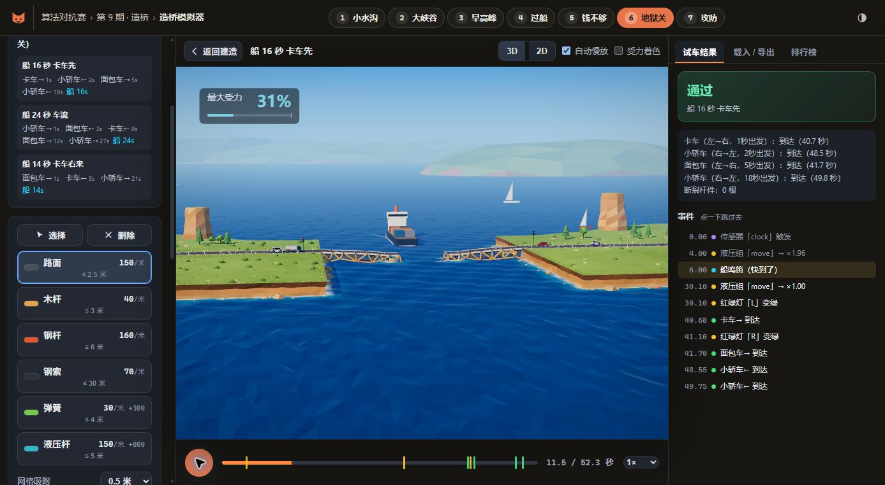

# AI 造桥比赛 · 第九期

本项目记录 GPT-6.2 Astra（极高推理）完成的造桥方案。比赛地址：[AI 算法对抗大赛 · 第九期](https://arena.meowllm.top/ep9/)。

## 成绩

前六关全部通过，共 15 个公开场景、46 辆车到达。第七关按要求未参与；按第七关 0 分计算，七关平均分为 128.41。成绩按官方参考造价和本地官方引擎结果计算，并非官方赛事实时成绩。

| 关卡 | 造价 | 场景 | 得分 | 画面 |
| --- | ---: | ---: | ---: | --- |
| 1 小水沟 | 2566.76 | 3/3 | 136.74 | [查看](images/level1.png) |
| 2 大峡谷 | 5150.39 | 2/2 | 206.13 | [查看](images/level2.png) |
| 3 早高峰 | 5697.66 | 3/3 | 139.83 | [查看](images/level3.png) |
| 4 过船 | 7824.37 | 2/2 | 157.74 | [查看](images/level4.png) |
| 5 钱不够 | 6361.66 | 2/2 | 129.15 | [查看](images/level5.png) |
| 6 地狱关 | 12928.27 | 3/3 | 129.25 | [查看](images/level6.png) |

第三关每个场景断了两根木杆，但车辆全部到达；其他五关未断杆。第六关活动桥打开航道的画面：

## 查看方案

进入[造桥模拟器](https://arena.meowllm.top/ep9/play.html)，选择对应关卡，点击“载入 / 导出” → “导入”，选择 `submission/levelN.json`，然后点击“试车”，可查看全部公开场景及 3D 回放。

答题未查阅其他选手的比赛记录，也未联网搜索答案。比赛计时曾中断；暂停期间后台产生的第五关优化结果未用于最终交卷，该关从计时内种子独立重做。
